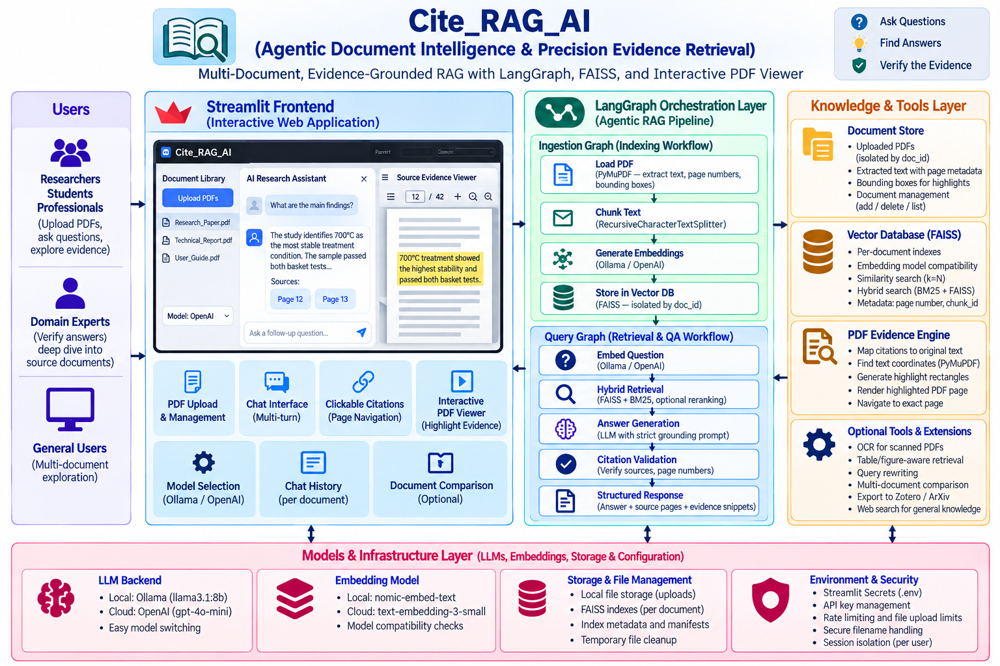
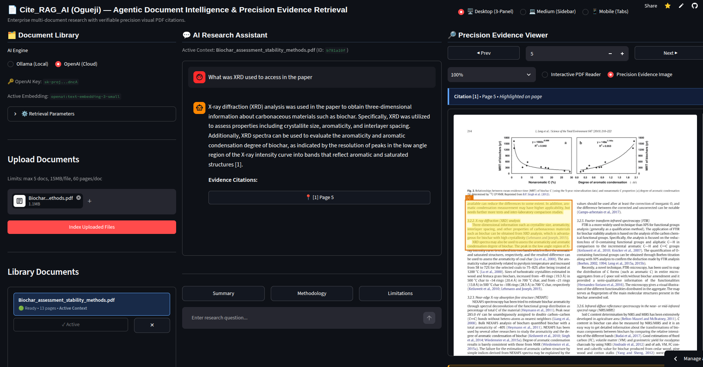
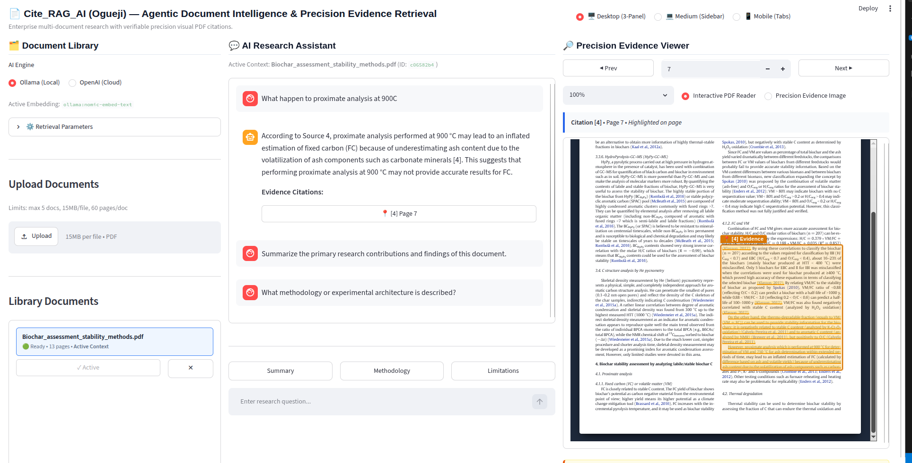
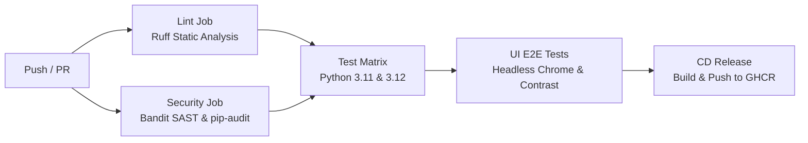

# 📄 Cite_RAG_AI (Ogueji) — Agentic Document Intelligence & Precision Evidence Retrieval

[](https://github.com/miracle/pdf-rag-reader/actions/workflows/ci.yml)
[](https://github.com/miracle/pdf-rag-reader/actions/workflows/cd.yml)
[](https://www.python.org/)
[](https://streamlit.io)
[](https://langchain-ai.github.io/langgraph/)
[](https://pymupdf.readthedocs.io/)
[](LICENSE)

**Cite_RAG_AI** is an enterprise-grade, multi-document Retrieval-Augmented Generation (RAG) platform built with **Streamlit**, **LangGraph**, **FAISS**, **BM25**, and **PyMuPDF**. It enables researchers, analysts, and engineers to upload multi-page scientific papers and complex documents, ask natural-language questions, and receive strictly grounded answers with verifiable inline citations (`[1]`, `[2]`).

Clicking any citation navigates the integrated **Precision Evidence Viewer** to the exact cited page, draws high-contrast yellow/amber bounding boxes around the supporting text passages, and automatically synchronizes the view across multi-line snippets, rotated pages, and scientific equations.

---

## 🏗️ System Architecture & Engineering Design

<p align="center">
  
</p>

### Pipeline Execution Flow (LangGraph Orchestration)

```mermaid
flowchart TD
    subgraph Ingestion["1. Precision Ingestion Pipeline (LangGraph)"]
        A[PDF Upload] --> B[load_node\nPyMuPDF 1-indexed page text & dimensions]
        B --> C[chunk_node\nProvenance chunking: doc_id, chunk_id, text_span, bboxes]
        C --> D[embed_store_node\nFAISS index + index_meta.json + chunks_manifest.json]
        D --> E[(Isolated FAISS & Manifest\ndata/multi/vectorstores/{doc_id}_index)]
    end

    subgraph Query["2. Grounded Query Pipeline (LangGraph)"]
        F[User Question] --> G[embed_node\nConversational query rewrite & query embedding]
        G --> H[retrieve_node\nHybrid BM25 + FAISS with Reciprocal Rank Fusion]
        E -.-> H
        H --> I[answer_node\nStrictly grounded prompt requiring [1], [2] citations]
        I --> J[validate_citations_node\nVerify citations, extract bboxes, flag insufficient evidence]
    end

    subgraph UI["3. Synchronized Three-Panel UI (Streamlit)"]
        K[Click Citation Badge] --> L[Update viewer_page & active_citation]
        L --> M[Render Cited Page with High-Precision Highlight Boxes]
    end

    J --> K
```

---

## 📸 Live Application & Model Inference Showcase

Cite_RAG_AI features full support for both cloud-augmented reasoning and 100% offline, privacy-first local inference:

### ☁️ Cloud Model API Inference (OpenAI GPT-4o & text-embedding-3-small)
The multi-document research assistant operating with OpenAI cloud inference, demonstrating grounded conversational QA, clickable citation pills, and real-time synchronized PDF evidence highlighting:

<p align="center">
  
</p>

### 🖥️ Local Model Inference (Ollama Llama 3.1 & Nomic Embed)
Fully offline on-premise document intelligence powered by Ollama, enabling air-gapped document analysis with zero cloud data transmission, hybrid BM25 + FAISS retrieval, and yellow bounding-box evidence inspection:

<p align="center">
  
</p>

---

## 🌟 Key Features

- **Responsive Three-Panel Research Workspace**:
  - **Left Panel — Document Library**: Batch PDF uploading with secure filename sanitization, document list and selection, indexing progress, document deletion, backend selection, and retrieval parameter tuning.
  - **Center Panel — AI Research Assistant**: Conversational QA interface with per-document isolation, clickable source citations `[1]`, `[2]`, research follow-up prompts, and clear warnings when source evidence is insufficient.
  - **Right Panel — Precision Evidence Viewer**: Dual-mode PDF viewer (High-Precision Evidence Image with yellow highlight overlays vs Interactive PDF Reader), page navigation, zoom controls, exact text snippet inspect box, and automatic page synchronization on citation click.
- **PyMuPDF Precision Citation Engine**:
  - Full chunk provenance retention: `doc_id`, 1-indexed `page_number`, `chunk_id`, `source_text`, `text_span` character offsets, and bounding box coordinates `[x0, y0, x1, y1]`.
  - Multi-line and multi-rectangle highlight resolution on native PDF points.
  - Graceful fallback: If exact text coordinates cannot be established, the viewer navigates to the cited page and displays the source snippet without drawing misleading highlight boxes.
- **Strictly Grounded Answer Generation**:
  - LangGraph query workflow enforces strict evidence grounding and inline bracketed citations (`[1]`, `[2]`).
  - Validation node verifies citation numbers against retrieved evidence, safely strips hallucinated citations, and flags insufficient evidence when the context is inadequate.
- **Hybrid Retrieval (BM25 + FAISS) with Reciprocal Rank Fusion**:
  - Combines sparse keyword search (BM25Okapi) and dense vector search (FAISS) using Reciprocal Rank Fusion (RRF).
  - Configurable top-k parameter (1 to 8 passages).
  - Conversational query rewriting for follow-up questions.
  - Strict document isolation by default with an explicit opt-in for multi-document cross-retrieval.
- **Index Compatibility & Security**:
  - Stores `index_meta.json` with `embedding_model_id` to prevent crashes when switching between models with different embedding dimensions.
  - Sanitizes uploaded filenames to eliminate path traversal vulnerabilities (`../` and `..\`).
  - Restricts PDF reads to allowed managed directories.
  - Treats document text as untrusted data in LLM prompt templates to resist prompt injection.

---

## 📁 Repository Structure

```plaintext
pdf-rag-reader/
├── .github/
│   └── workflows/
│       ├── ci.yml             # CI: Linting (Ruff), Security (Bandit/pip-audit), Pytest matrix, UI test
│       └── cd.yml             # CD: Docker buildx, GHCR publish, Trivy container security audit
├── docs/
│   └── images/                # Architecture diagrams and application screenshots
│       ├── Cite_RAG_AI_Architecture_Diagram.png
│       ├── Cloud_model_API.png
│       └── Ollama_local_model_testing.png
├── app_multi.py               # Main 3-panel multi-document research assistant
├── app_single.py              # Lightweight single-document viewer mode
├── Dockerfile                 # Multi-stage production container image (non-root appuser)
├── docker-compose.yml         # Full-stack composition with companion Ollama service
├── pyproject.toml             # Unified tool configuration (Ruff, Bandit, Coverage)
├── pytest.ini                 # Pytest configuration and test markers
├── requirements.txt           # Production runtime dependencies
├── requirements-dev.txt       # Development, testing, and linting dependencies
├── .pre-commit-config.yaml    # Git pre-commit hooks
├── scripts/
│   └── ci_check.sh            # Local one-click CI verification script
├── models/                    # Model backend configurations
│   ├── __init__.py            # Model factories & embedding model ID resolution
│   ├── ollama_config.py       # Local Ollama LLM (llama3.1:8b) & embeddings (nomic-embed-text)
│   └── openai_config.py       # Cloud OpenAI LLM (gpt-4o-mini) & embeddings (text-embedding-3-small)
├── rag/                       # LangGraph orchestration graphs & retrieval
│   ├── __init__.py
│   ├── ingest_multi.py        # Multi-document ingestion LangGraph pipeline
│   ├── query_multi.py         # Multi-document grounded query LangGraph pipeline
│   ├── retriever.py           # Hybrid BM25 + FAISS retriever, RRF & query rewriter
│   ├── ingest_single.py       # Single-document ingestion workflow
│   └── query_single.py        # Single-document query workflow
├── utils/                     # Core utilities
│   ├── __init__.py
│   ├── citation_engine.py     # PyMuPDF citation resolution, bboxes & highlight renderer
│   ├── pdf_loader.py          # PyMuPDF page loader with 1-indexed numbering
│   ├── text_splitter.py       # Provenance-preserving chunk splitter
│   ├── vectorstore.py         # FAISS vector store with index metadata & compatibility checks
│   ├── pdf_viewer_component.py# Interactive PDF.js / canvas viewer component
│   └── security.py            # Upload filename sanitization & path traversal defense
├── tests/                     # Automated test suite (45 tests)
│   ├── conftest.py            # Test fixtures & deterministic mocks
│   ├── test_pdf_loader.py     # Ingestion, 1-indexed numbering, error handling
│   ├── test_citation_engine.py# Coordinates, multi-page citations, highlight rendering
│   ├── test_isolation_and_retrieval.py # Strict isolation, cross-doc mode, hybrid BM25
│   ├── test_grounded_qa.py    # Grounded answer validation & insufficient evidence
│   ├── test_index_compatibility_and_security.py # Model compatibility & upload security
│   ├── test_app_state_and_smoke.py # UI state synchronization & Streamlit smoke test
│   ├── test_layout_and_responsiveness.py # Multi-viewport responsiveness & overflow guards
│   ├── test_precision_evidence_highlighting.py # Multiline & scientific formula bounding boxes
│   └── test_theme_consistency.py # WCAG AA contrast ratios & live Light/Dark theme checks
├── data/                      # File storage (created dynamically)
│   ├── multi/
│   │   ├── uploads/           # Uploaded PDFs ({doc_id}_{filename})
│   │   └── vectorstores/      # Isolated indexes ({doc_id}_index)
│   └── single/
└── README.md                  # Project documentation
```

---

## ⚙️ Prerequisites & Installation

### 1. Environment Setup

```bash
cd /home/miracle/Documents/agy-cli-projects/pdf-rag-reader
python3 -m venv venv
source venv/bin/activate
```

### 2. Install Dependencies

```bash
# Production runtime dependencies
pip install -r requirements.txt

# Development, testing, linting, and security tools
pip install -r requirements-dev.txt
```

### 3. Backend Configuration

- **Local Inference (Ollama - default)**:
  - Install Ollama from [ollama.com](https://ollama.com)
  - Pull models:
    ```bash
    ollama pull llama3.1:8b
    ollama pull nomic-embed-text
    ```
- **Cloud Inference (OpenAI - optional)**:
  - Set your API key in `.env`:
    ```bash
    OPENAI_API_KEY=sk-...
    ```
  - Alternatively, enter the key directly in the application UI.

---

## 🖥️ Launching the Application

### Option A: Local Python / Streamlit

```bash
./venv/bin/streamlit run app_multi.py
```

### Option B: Docker Container

Build and run the hardened production container with non-root execution and healthchecks:

```bash
# Build production Docker image
docker build -t pdf-rag-reader:latest .

# Run container on port 8501
docker run -d \
  --name pdf-rag-reader \
  -p 8501:8501 \
  -v pdf_rag_data:/app/data \
  -e OPENAI_API_KEY="sk-..." \
  pdf-rag-reader:latest
```

### Option C: Docker Compose (Full Stack with Companion Ollama)

Launch both the PDF RAG Reader and a local Ollama instance with GPU/CPU acceleration and persistent volume caching:

```bash
# Start all services in the background
docker compose up -d

# View service logs
docker compose logs -f pdf-rag-reader

# Check container health status
docker compose ps
```

---

## 🚀 CI/CD Pipeline Architecture

This repository uses automated, production-grade GitHub Actions workflows to ensure strict code quality, security, and continuous delivery:



### 1. Continuous Integration (`.github/workflows/ci.yml`)
- **Linting & Hygiene**: Astral `ruff` checks syntax, imports, code quality, and formatting rules.
- **Security & SAST**: `bandit` performs static application security testing against code injection, unsafe deserialization, and path attacks. `pip-audit` verifies that all third-party dependencies are free from known CVEs.
- **Matrix Testing**: Pytest suite runs across **Python 3.11 and 3.12** with system OCR libraries (`tesseract-ocr`) and graphics engines (`libgl1`, `libglib2.0-0`), generating XML coverage reports.
- **Headless Browser E2E Tests**: Spins up the application in a headless Chrome environment to test responsive layout viewports (1440px, 1280px, 1024px, 768px, 390px) and WCAG AA color contrast consistency in both Light and Dark modes.

### 2. Continuous Delivery (`.github/workflows/cd.yml`)
- **Automated Container Builds**: Builds multi-stage production Docker images on tag releases (`v*.*.*`) or main pushes.
- **Layer Caching**: Uses GitHub Actions Cache (`type=gha`) for rapid, sub-minute builds.
- **GitHub Container Registry (GHCR)**: Automatically tags (`v1.0.0`, `1.0`, `latest`, commit SHA) and publishes images to `ghcr.io`.
- **Image Scanning**: Runs automated vulnerability scans via Aquasecurity Trivy before release.

### 3. Local CI Verification Script
Before pushing code, run the all-in-one local verification script to execute all CI stages in seconds:

```bash
./scripts/ci_check.sh
```

To enable pre-commit checks automatically:
```bash
pre-commit install
```

---

## 🧪 Running the Automated Test Suite

The test suite contains **45 comprehensive unit, integration, and UI tests** with deterministic fixtures:

```bash
# Run all unit and integration tests (excluding live browser tests)
./venv/bin/pytest -m "not browser"

# Run headless browser viewport and theme contrast tests (requires Streamlit running on 8501)
./venv/bin/pytest -m browser

# Run the complete test suite with coverage
./venv/bin/pytest --cov=models --cov=rag --cov=utils --cov-report=term-missing
```

### Test Coverage Highlights:
- `test_precision_evidence_highlighting.py`: Multiline evidence localization, scientific formulas, tables, page rotation transformations, and amber outline rendering.
- `test_theme_consistency.py`: CSS variable token hygiene, WCAG AA mathematical contrast (>4.5:1), and headless Chrome live theme contrast checks.
- `test_layout_and_responsiveness.py`: Viewport testing across 5 standard screen sizes, horizontal overflow prevention, and citation synchronization.
- `test_pdf_loader.py`: Ingestion, 1-indexed numbering, metadata extraction, OCR fallback, and corrupted file handling.
- `test_citation_engine.py`: Text bounding box calculations, multi-page citations, and unverified position fallbacks.
- `test_isolation_and_retrieval.py`: Strict document isolation between independent documents, hybrid BM25 lexical ranking, and cross-document search.
- `test_grounded_qa.py`: Grounded citation validation, hallucinated citation stripping, and insufficient evidence rejection.
- `test_index_compatibility_and_security.py`: Embedding dimensionality mismatch protection, filename sanitization, and path traversal defense.
- `test_app_state_and_smoke.py`: Session state synchronization, app compilation, and headless smoke testing.

---

## ⚠️ Known Limitations

1. **Scanned & OCR Documents**: PyMuPDF extracts existing text layers. If a document consists solely of raster images without embedded text (scanned PDF), the built-in Tesseract OCR fallback extracts page text, but processing time is slightly longer.
2. **Visual Ligatures & Complex Typesetting**: For rare mathematical equations or custom typography where character spacing differs drastically from extracted text, the citation engine falls back to displaying the page and snippet without drawing misleading bounding boxes.
3. **Model Dimensionality**: FAISS indexes are tied to the vector dimensions of the embedding model used during ingestion (`nomic-embed-text`: 768 dims, `text-embedding-3-small`: 1536 dims). If you switch backends, use the built-in "Re-index Document" button to regenerate the index for the new model.

---

## 📄 License

This project is licensed under the MIT License.
